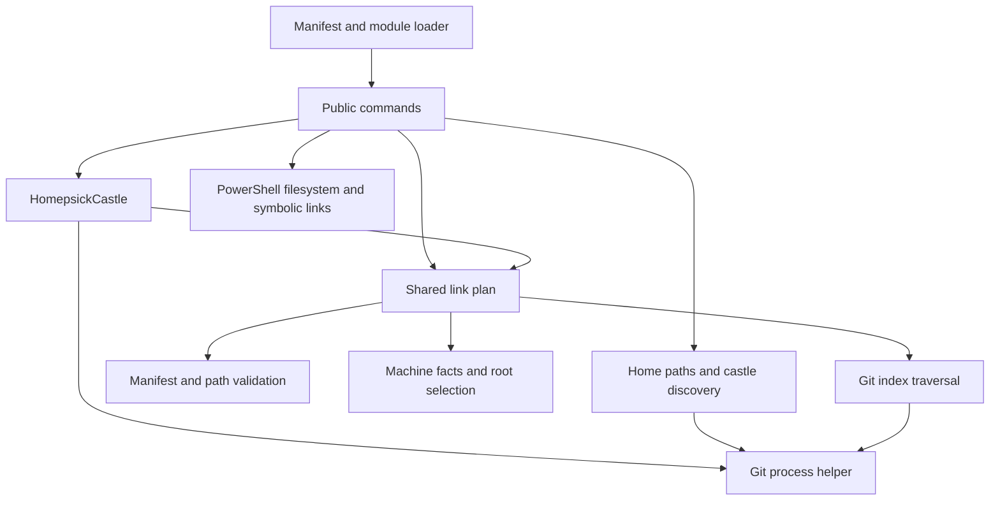

# Contributor and architecture guide

[Documentation index](README.md#documentation) · [Command reference](commands.md)

## Repository layout

| Path | Responsibility |
| --- | --- |
| [src/Homepsick.psd1](../src/Homepsick.psd1) | Manifest, version, minimum PowerShell version, explicit public export list |
| [src/Homepsick.psm1](../src/Homepsick.psm1) | Dot-source types/functions, register the class accelerator, export public functions, remove the accelerator on unload |
| [src/Public/](../src/Public) | Ten user-facing functions, parameter binding, orchestration and prompts |
| [src/Private/](../src/Private) | Manifest validation, facts, selection/planning, path safety, tracking and Git helpers |
| [src/Types/](../src/Types) | One class per file for `HomepsickCastle` and internal manifest, fact, plan and diagnostic contracts |
| [tests/](../tests) | Lifecycle, manifest, tracking, workflow, safety, fact and path/expansion suites using temporary homes and local Git sources |
| [tests/Invoke-HomepsickTests.ps1](../tests/Invoke-HomepsickTests.ps1) | Full-suite runner, command coverage and report artifacts |
| [.github/workflows/test.yml](../.github/workflows/test.yml) | GitHub Actions Windows/Linux Pester jobs |
| [README.md](../README.md) | Project introduction and pointers to detailed documentation |
| [docs/README.md](README.md), [docs/](.) | Detailed entry point, command examples and user/contributor guides |
| [LICENSE](../LICENSE) | MIT license |

There is no build project, generated module bundle, dependency lockfile or packaging script. The optional castle schema is implemented by [Get-HomepsickManifest](../src/Private/Get-HomepsickManifest.ps1) and documented in [the manifest guide](manifests.md).

## Import and public API

The loader lists class files in an explicit dependency order, then enumerates public/private `.ps1` files. Base classes and property types must load before their dependents; alphabetical enumeration is insufficient. Each module-level function and class has its own file. Import errors are written as errors; the loop can continue, so inspect the first import error rather than assuming a partial load is usable. Class methods and public functions refer to helpers available when invoked after loading.

Each public filename's basename is passed to `Export-ModuleMember`. Importing via the manifest additionally filters through `FunctionsToExport`; both places matter when adding a command. There are no aliases or public private-helper exports. Direct `.psm1` import can differ in metadata and exports from manifest import if these lists drift, which is why contributor validation should exercise both.

The loader uses PowerShell's internal `TypeAccelerators` API to expose `[HomepsickCastle]`, refusing to clobber an existing accelerator. Other classes remain internal; public result objects expose their documented properties, with string `OutputType` metadata on the public preview/validation commands. `OnRemove` unregisters the accelerator. PowerShell class definitions can outlive removal; use a fresh process when changing types.

## Runtime responsibilities



- [Get-HomePath](../src/Private/Get-HomePath.ps1) selects nonblank `env:HOME` or the .NET user profile. [Get-HomepsickPath](../src/Private/Get-HomepsickPath.ps1) appends fixed `.homesick` and `repos` components. Named manifest destinations do not change castle storage.
- [Get-HomepsickNames](../src/Private/Get-HomepsickNames.ps1) enumerates immediate directory children, accepting a `.git` entry or Git's inside-worktree result. Named `Get-HomepsickCastle` constructs a class object and checks directory existence only.
- `HomepsickCastle` calculates paths once, exposes inventory and origin helpers, and implements pull/submodule update. Its `Exists()` checks a directory, not Git integrity. `Update()` returns early without an upstream and otherwise runs `pull` and `submodule update --init --recursive`.
- [Get-HomepsickTrackedFile](../src/Private/Get-HomepsickTrackedFile.ps1) parses NUL-separated staged index entries and recurses through mode `160000` entries. Legacy callers receive home-relative inventory; `-AllRoots` preserves full repository-relative paths for the planner. Only indexed sources are candidates, with repeated stages of one working file deduplicated by the plan.
- [Enable-HomepsickCastle](../src/Public/Enable-HomepsickCastle.ps1) executes the shared plan, rechecks manifest safety/ownership before writes and applies ordinary conflict policy between castles. It never recursively replaces real directory conflicts. There is no ownership database or stale-link reconciliation.
- [Add-HomepsickFile](../src/Public/Add-HomepsickFile.ps1) reverses applicable manifest mappings, requires a storage choice when ambiguous, checks ignore rules, moves/stages entries and rebuilds the plan to link the winner. Rollback restores the current original and its prior index stages while preserving unrelated staged work. It does not provide atomic rollback of an entire call.
- [Invoke-HomepsickGit](../src/Private/Invoke-HomepsickGit.ps1) starts `git -C <repository>` using `ProcessStartInfo.ArgumentList` with no shell. It drains stdout/stderr asynchronously, waits synchronously, returns `ExitCode`/`Output`/`Error`, and disposes the process. Nonzero exits throw unless `-AllowFailure` is supplied. There is no timeout, cancellation parameter, progress streaming or retry policy. Some probes intentionally tolerate failures; notably status can classify remote failure as `Uncheckable`.
- Update's before/after `HEAD` diff gates optional relinking; refresh gates update by `FETCH_HEAD` age. These are different checks from status's live `ls-remote` comparison. See their [exact contracts](commands.md).

Filesystem behavior comes from PowerShell cmdlets, .NET paths and installed Git. Platform facts use PowerShell OS flags, Linux os-release data or Windows CIM data. There is no permission escalation, copy fallback, external package integration or background service.

## Manifest selection and shared resolution

[Get-HomepsickManifest](../src/Private/Get-HomepsickManifest.ps1) validates raw JSON shape/values before producing typed roots, destinations and diagnostics. It checks source declarations and potential overlaps without choosing file winners or reading environment variables. [Get-HomepsickMachineFact](../src/Private/Get-HomepsickMachineFact.ps1) accepts injected raw detection contexts or complete `-MachineFacts`, and [Get-HomepsickRootSelection](../src/Private/Get-HomepsickRootSelection.ps1) records matching/skipping reasons. Inferred OS eligibility stays separate from explicitly declared condition scores.

[Resolve-HomepsickLinkPlan](../src/Private/Resolve-HomepsickLinkPlan.ps1) enumerates tracked sources, resolves selected destinations, arbitrates files within the castle, and classifies existing conflicts and managed relationships. Validation, preview, enable, manifest inventory and tracking share this implementation. Keep actual equal-priority ties as errors before linking, rather than relying on manifest or enumeration order. Cross-castle collisions retain ordinary conflict handling.

[ConvertTo-HomepsickDestination](../src/Private/ConvertTo-HomepsickDestination.ps1) validates destination components and normalizes literal paths; [Resolve-HomepsickDestination](../src/Private/Resolve-HomepsickDestination.ps1) reads one leading environment variable for selected targets, then normalizes before authorization. No expression evaluation or recursive expansion occurs. Inactive environment targets stay unread, except their mappings can reuse an active entry's already-resolved named destination for ownership checks. Keep source/`into`/tracked-relative validation strict when changing destination navigation rules.

The planner rejects unsafe manifest sources and redirected destination parents, while outside-home writes require both declaration and opt-in. Enable and tracking recheck relevant paths immediately before modifying them. Ordinary no-manifest layouts retain their legacy path semantics; regression tests must cover them separately.

## Development prerequisites and loading

Use PowerShell 7.4+, Git and Pester 5. CI currently pins Pester 5.7.1. No compiler/build command is needed. From the repository root:

```powershell
Import-Module ./src/Homepsick.psd1 -ErrorAction Stop
Get-Command -Module Homepsick -Syntax
Test-ModuleManifest ./src/Homepsick.psd1
```

Perform manual link/file experiments only under a temporary home, using the [sandbox pattern](configuration.md#home-and-path-overrides). Restore `env:HOME` in `finally`. Use local repositories and explicit repository-local test identities for commits. Do not test against actual user dotfiles. Be aware that changing `HOME` also affects Git configuration discovery on Unix, and using `$HOME` after changing `env:HOME` will not select the sandbox.

## Tests and static checks

To install the same Pester version as CI in your user module path, if needed:

```powershell
Install-Module Pester -RequiredVersion 5.7.1 -Scope CurrentUser
```

This installation is a development dependency and modifies your user module directory, not homepsick runtime configuration. For disposable validation, `Save-Module -Name Pester -RequiredVersion 5.7.1 -Path <temporary-module-directory>` and import its manifest by absolute path instead.

Run the suite in a fresh `pwsh -NoProfile` process:

```powershell
Import-Module Pester -RequiredVersion 5.7.1
$result = Invoke-Pester -Path ./tests -PassThru -Output Detailed
if ($result.FailedCount -gt 0 -or $result.FailedContainersCount -gt 0) { exit 1 }
```

Tests exercise manifest and direct-module imports, save/restore `env:HOME` and other environment fixtures, and use Pester's temporary `TestDrive`. The ordinary lifecycle suite remains alongside focused manifest selection, detection, validation, tracking, conflict and clone/pull suites. Local-file submodule tests temporarily permit only the `file` protocol and restore the setting. Tests use local remotes, explicit fixture identities and failure injection rather than actual user dotfiles or authenticated external sources.

### Cross-platform facts and path regressions

Inject raw Linux os-release and Windows CIM contexts to test product normalization on either CI host. Include Windows role/release/edition independence, Windows 10/11 and Server builds/SKUs, unknown facts, Linux release IDs and multiple `ID_LIKE` lineages. Do not rely on the CI host's identity to exercise the other platform's logic.

Destination tests cover both Windows separator styles, drive inference, inactive foreign paths, missing sources/variables, case rules, environment syntax and lexical navigation. Native writes stay under TestDrive; synthetic facts do not emulate a foreign filesystem. Cover priorities without inferred OS points, singleton arrays, actual ties, shadowing, normalized aliases, external opt-in, WhatIf, directory preservation and managed-link ownership. Tracking failures must assert original files and index state, including unrelated staged work.

### Command coverage reports

Run the same full-suite coverage command as CI with Pester 5.7.1:

```powershell
./tests/Invoke-HomepsickTests.ps1 -ReportDirectory ./artifacts/coverage/local
```

The runner writes `coverage.xml` in JaCoCo format, `missed-commands.csv` and `summary.json`. Coverage measures executed production commands, not passing-test percentage or complete branch coverage. It is informational with no percentage gate. Inspect missed safety paths and assert observable filesystem/index behavior; do not add tests that merely mirror implementation or hit commands.

There is no configured PSScriptAnalyzer, Markdown lint or help-generation CI job. For local static analysis with PSScriptAnalyzer installed:

```powershell
Import-Module ./src/Homepsick.psd1 -ErrorAction Stop
& (Get-Module Homepsick) { Invoke-ScriptAnalyzer -Path ./src -Recurse }
```

Load module types first: standalone analysis of individual private class files can report unresolved dependencies. Treat analysis as a diagnostic, not a currently clean CI gate; compare findings with the base branch before proposing unrelated code changes. The validation command has a narrowly documented suppression for string metadata naming a private PowerShell result type. For documentation edits, verify relative links/fragments, parse PowerShell and JSON examples, compare syntax/parameters/exports with `Get-Command`, and render command help. Exercise representative operations in temporary directories; do not write tests that merely assert prose wording.

## CI, versions and distribution

GitHub Actions runs on pushes and pull requests, checking out with `actions/checkout@v4`, installing Pester **5.7.1** with `-Scope CurrentUser -Force -SkipPublisherCheck`, and invoking the coverage runner under hosted `pwsh`. Its matrix is `ubuntu-latest` and `windows-latest`. Failed tests or containers fail the job. Each platform uploads its coverage/summary artifacts even after a failure. The PowerShell version is not pinned to the manifest minimum and there is no macOS job.

The version is the literal `ModuleVersion = '0.2.0'` in the manifest. Source checkout/import is the documented distribution method. No Gallery publication, release/tag automation, semantic-release configuration, generated changelog or module-signing process is defined by tracked files. Git commit signing is distinct from PowerShell module signing. Use Conventional Commits for contribution history; do not invent an automated version bump or publish step.

## Extending the module

1. Add a focused function in `src/Public/<Verb>-Homepsick<Noun>.ps1` using existing parameter and error conventions. Keep implementation-only functions in `Private`.
2. Add its name to manifest `FunctionsToExport`; verify both manifest and direct-module import. Do not accidentally export helpers or introduce aliases without documenting the public contract.
3. Document syntax-accurate parameter descriptions, input/output, side effects, errors and examples in the [command reference](commands.md). Update the workflow guides and any changed defaults. Keep source synopses consistent; the comprehensive reference and examples live under `docs/`.
4. Add behavior tests for success, failure and edge cases. Changes to file/link handling should cover existing regular files/directories, correct/wrong/broken links, ancestor conflicts, spaces, ignore rules, dry runs and partial failures. Test collisions across castles and case behavior on relevant filesystems. Git work should use local sources and test upstream absence, dirty worktrees, divergence and submodules as appropriate.
5. Run tests and relevant diagnostics in isolation. When extending the manifest schema or conditions, preserve no-manifest behavior, explicit-field scoring, invalid-input diagnostics, deterministic ties and shared preview/execution resolution. Add a class file to the loader's dependency list when introducing a typed contract.

## Known implementation limitations for maintainer review

These limitations remain alongside the manifest safeguards. Distinguish legacy execution behavior from the stricter manifest path checks.

| Finding and source | Practical workaround / possible remediation |
| --- | --- |
| [Tracked-file parser](../src/Private/Get-HomepsickTrackedFile.ps1) omits newline-containing names: regex `.*` does not span embedded newlines, despite the NUL separator comment. Reproduced on Linux. | Avoid those names. A code change should parse the metadata/path delimiter without losing embedded newlines and add a regression test. |
| [Legacy enable target comparison](../src/Public/Enable-HomepsickCastle.ps1) retains case-insensitive `-eq` for no-manifest castles, so a wrong case-only target can be accepted on Linux. Manifest execution uses OS-appropriate comparison. | Inspect and manually replace the confirmed legacy wrong link; force alone still takes the already-linked branch. |
| [Enable ancestor handling](../src/Public/Enable-HomepsickCastle.ps1) does not replace blocking ancestors. Manifest plans reject them before writing; legacy linking can fail during directory creation. | Preserve and reorganize the ancestor manually. Force never repairs it or recursively replaces a real directory conflict. |
| [Status](../src/Public/Get-HomepsickCastleStatus.ps1) labels absent remote objects `Behind`, even when ancestry is unknown, and does not surface dirty state alongside ahead/behind/diverged. | Use Git status and a deliberate fetch for diagnosis. Consider separate synchronization and working-copy fields or an unknown-ancestry result. |
| [Update](../src/Public/Update-HomepsickCastle.ps1) gates `-Link` on changed `HEAD` plus qualifying paths: legacy `home/` additions/renames or manifest/selected-root changes. | Invoke enable explicitly for repairs, machine/environment changes or unchanged `HEAD`. |
| [Discovery](../src/Private/Get-HomepsickNames.ps1) can accept a child directory merely because Git finds an ancestor working tree. | Keep storage outside another repository. A fix should verify the returned repository top-level matches the candidate. |
| [Link replacement](../src/Public/Enable-HomepsickCastle.ps1) has no rollback; [add](../src/Public/Add-HomepsickFile.ps1) restores only its current failed entry, not an entire multi-file operation. | Preserve originals and inspect both paths/index after failure. Rollback can itself fail under filesystem errors. |

New, add, enable and update implement `ShouldProcess`; refresh itself has no `WhatIf`. The reference lists the actual support. Stale links without a replacement winner are not automatically removed, and structural managed ownership does not record historical state.

## Documentation validation scope

Documentation checks should cover all guides together, including navigation from the project README, syntax for every exported command, JSON examples and shared cross-references. Parse examples without executing real-profile or authenticated Git mutations. Exercise new workflows under temporary homes and local repositories, then record actual checks in the PR rather than keeping a stale passing-test count in the guides.

Native Windows/Linux CI results and injected product-fact tests provide different evidence: a passing hosted job does not verify every actual Windows product/edition acquisition path. macOS, the exact 7.4 minimum, arbitrary remote authentication, Gallery availability, module signing and execution of homeshick/homesick require separate validation. Do not infer them from command coverage or a shared repository layout.
