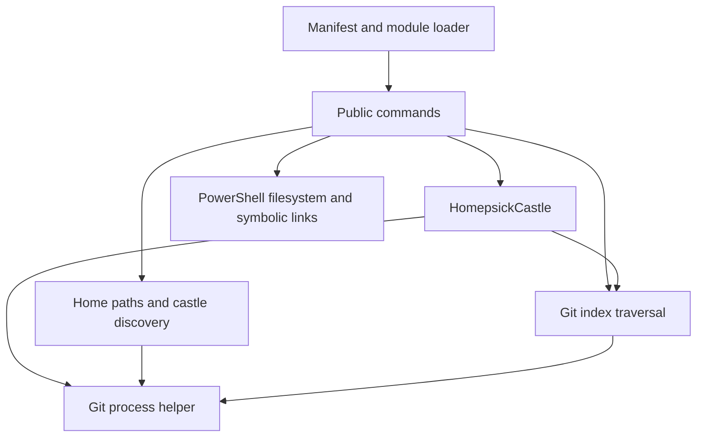

# Contributor and architecture guide

[Documentation index](README.md#documentation) · [Command reference](commands.md)

## Repository layout

| Path | Responsibility |
| --- | --- |
| [src/Homepsick.psd1](../src/Homepsick.psd1) | Manifest, version, minimum PowerShell version, explicit public export list |
| [src/Homepsick.psm1](../src/Homepsick.psm1) | Dot-source types/functions, register the class accelerator, export public functions, remove the accelerator on unload |
| [src/Public/](../src/Public) | Eight user-facing functions, parameter binding, orchestration and prompts |
| [src/Private/](../src/Private) | Home/storage paths, discovery, Git execution, index traversal and existence checks |
| [src/Types/HomepsickClass.ps1](../src/Types/HomepsickClass.ps1) | `HomepsickCastle` properties and repository methods |
| [tests/Parity.Tests.ps1](../tests/Parity.Tests.ps1) | Nine Pester lifecycle tests using temporary homes and local Git sources |
| [.github/workflows/test.yml](../.github/workflows/test.yml) | GitHub Actions Windows/Linux Pester jobs |
| [README.md](../README.md) | Project introduction and pointers to detailed documentation |
| [docs/README.md](README.md), [docs/](.) | Detailed entry point, command examples and user/contributor guides |
| [LICENSE](../LICENSE) | MIT license |

There is no build project, generated module bundle, dependency lockfile, configuration schema or packaging script.

## Import and public API

The loader enumerates `.ps1` files in `Types`, `Public` and `Private`, dot-sourcing them in that group order. Import errors are written as errors; the loop can continue, so inspect the first import error rather than assuming a partial load is usable. Class methods and public functions refer to helpers available when invoked after loading.

Each public filename's basename is passed to `Export-ModuleMember`. Importing via the manifest additionally filters through `FunctionsToExport`; both places matter when adding a command. There are no aliases or public private-helper exports. Direct `.psm1` import can differ in metadata and exports from manifest import if these lists drift, which is why contributor validation should exercise both.

The loader uses PowerShell's internal `TypeAccelerators` API to expose `[HomepsickCastle]`, refusing to clobber an existing accelerator. Its `OnRemove` callback unregisters the accelerator. PowerShell class definitions can outlive removal; use a fresh process when changing types.

## Runtime responsibilities



- [Get-HomePath](../src/Private/Get-HomePath.ps1) selects nonblank `env:HOME` or the .NET user profile. [Get-HomepsickPath](../src/Private/Get-HomepsickPath.ps1) appends fixed `.homesick` and `repos` components. There is no configuration-file loading phase.
- [Get-HomepsickNames](../src/Private/Get-HomepsickNames.ps1) enumerates immediate directory children, accepting a `.git` entry or Git's inside-worktree result. Named `Get-HomepsickCastle` constructs a class object and checks directory existence only.
- `HomepsickCastle` calculates paths once, exposes inventory and origin helpers, and implements pull/submodule update. Its `Exists()` checks a directory, not Git integrity. `Update()` returns early without an upstream and otherwise runs `pull` and `submodule update --init --recursive`.
- [Get-HomepsickTrackedFile](../src/Private/Get-HomepsickTrackedFile.ps1) parses NUL-separated staged index entries, recurses through mode `160000` entries and emits `RelativePath`/`SourcePath` pairs beneath literal `home/`. There is no conditional selection, scoring or deduplication of unresolved stages.
- [Enable-HomepsickCastle](../src/Public/Enable-HomepsickCastle.ps1) maps those pairs into home destinations, checks existing link targets and applies conflict policy before filesystem operations. It has no ownership database or stale-link reconciliation.
- [Add-HomepsickFile](../src/Public/Add-HomepsickFile.ps1) validates lexical home containment, expands ordinary directories, checks ignore rules, moves entries, rebases relative source symlinks, links back and stages. Its catch block attempts per-entry restoration on terminating failures; it does not provide atomic rollback of an entire call or index.
- [Invoke-HomepsickGit](../src/Private/Invoke-HomepsickGit.ps1) starts `git -C <repository>` using `ProcessStartInfo.ArgumentList` with no shell. It drains stdout/stderr asynchronously, waits synchronously, returns `ExitCode`/`Output`/`Error`, and disposes the process. Nonzero exits throw unless `-AllowFailure` is supplied. There is no timeout, cancellation parameter, progress streaming or retry policy. Some probes intentionally tolerate failures; notably status can classify remote failure as `Uncheckable`.
- Update's before/after `HEAD` diff gates optional relinking; refresh gates update by `FETCH_HEAD` age. These are different checks from status's live `ls-remote` comparison. See their [exact contracts](commands.md).

Platform behavior comes directly from PowerShell filesystem cmdlets, .NET paths and installed Git. There are no dedicated Windows/Linux/macOS adapters, permission escalation, copy fallback, external package integrations or background services.

## Development prerequisites and loading

Use PowerShell 7.4+, Git and Pester 5. CI currently pins Pester 5.7.1. No compiler/build command is needed. From the repository root:

```powershell
Import-Module ./src/Homepsick.psd1 -ErrorAction Stop
Get-Command -Module Homepsick -Syntax
Test-ModuleManifest ./src/Homepsick.psd1
```

Perform manual link/file experiments only under a temporary home, using the [sandbox pattern](configuration.md#home-and-path-overrides). Restore `env:HOME` in `finally`. Use local repositories and explicit repository-local test identities for commits. Do not test against actual user dotfiles. Be aware that changing `HOME` also affects Git configuration discovery on Unix, and using `$HOME` after changing `env:HOME` will not select the sandbox.

## Tests and static checks

To install the same Pester version as CI in your user module path, if needed:

```powershell
Install-Module Pester -RequiredVersion 5.7.1 -Scope CurrentUser
```

This installation is a development dependency and modifies your user module directory, not homepsick runtime configuration. For disposable validation, `Save-Module -Name Pester -RequiredVersion 5.7.1 -Path <temporary-module-directory>` and import its manifest by absolute path instead.

Run the suite in a fresh `pwsh -NoProfile` process:

```powershell
Import-Module Pester -RequiredVersion 5.7.1
$result = Invoke-Pester -Path ./tests -PassThru -Output Detailed
if ($result.FailedCount -gt 0) { exit 1 }
```

The tests import `.psm1` directly, save/restore `env:HOME`, and use Pester's temporary `TestDrive`. They cover generation/discovery, file tracking/staging, batch/forced/WhatIf linking, spaces/broken links, lexical home rejection, clone/status/pull/link/location, stale refresh, initialized submodules and several status outcomes. A local-file submodule test temporarily permits only the `file` protocol and restores the setting. They do not establish full platform or feature parity.

There is no configured PSScriptAnalyzer, Markdown lint or help-generation CI job. For local static analysis with PSScriptAnalyzer installed:

```powershell
Invoke-ScriptAnalyzer -Path ./src -Recurse
```

Treat this as an optional diagnostic, not a currently clean CI gate. Check findings against the baseline before proposing unrelated code changes. For documentation edits, verify relative links and fragments, parse PowerShell examples, compare syntax/parameters/exports with `Get-Command`, and render command help. Exercise representative operations in temporary directories; do not write tests that merely assert prose wording.

## CI, versions and distribution

GitHub Actions runs on pushes and pull requests, checking out with `actions/checkout@v4`, installing Pester **5.7.1** with `-Scope CurrentUser -Force -SkipPublisherCheck`, and running the pass-through invocation above under hosted `pwsh`. Its matrix is `ubuntu-latest` and `windows-latest`. It fails explicitly when `FailedCount` is nonzero. The PowerShell version is not pinned to the manifest minimum and there is no macOS job.

The version is the literal `ModuleVersion = '0.2.0'` in the manifest. Source checkout/import is the documented distribution method. No Gallery publication, release/tag automation, semantic-release configuration, generated changelog or module-signing process is defined by tracked files. Git commit signing is distinct from PowerShell module signing. Use Conventional Commits for contribution history; do not invent an automated version bump or publish step.

## Extending the module

1. Add a focused function in `src/Public/<Verb>-Homepsick<Noun>.ps1` using existing parameter and error conventions. Keep implementation-only functions in `Private`.
2. Add its name to manifest `FunctionsToExport`; verify both manifest and direct-module import. Do not accidentally export helpers or introduce aliases without documenting the public contract.
3. Document syntax-accurate parameter descriptions, input/output, side effects, errors and examples in the [command reference](commands.md). Update the workflow guides and any changed defaults. Keep source synopses consistent; the comprehensive reference and examples live under `docs/`.
4. Add behavior tests for success, failure and edge cases. Changes to file/link handling should cover existing regular files/directories, correct/wrong/broken links, ancestor conflicts, spaces, ignore rules, dry runs and partial failures. Test collisions across castles and case behavior on relevant filesystems. Git work should use local sources and test upstream absence, dirty worktrees, divergence and submodules as appropriate.
5. Run tests and relevant diagnostics in isolation. If introducing configuration or conditional selection, define and test a real schema, invalid-input behavior, matching rules, ordering and ties before documenting it as available.

## Known implementation limitations for maintainer review

Documentation follows current code; these are not fixes included in this change.

| Finding and source | Practical workaround / possible remediation |
| --- | --- |
| [Tracked-file parser](../src/Private/Get-HomepsickTrackedFile.ps1) omits newline-containing names: regex `.*` does not span embedded newlines, despite the NUL separator comment. Reproduced on Linux. | Avoid those names. A code change should parse the metadata/path delimiter without losing embedded newlines and add a regression test. |
| [Enable target comparison](../src/Public/Enable-HomepsickCastle.ps1) uses case-insensitive `-eq` on normalized paths; a wrong case-only target is accepted on a case-sensitive filesystem. Reproduced on Linux. | Inspect and manually replace the confirmed wrong link; force alone still takes the already-linked branch. A fix should use comparison appropriate to the filesystem and test both cases. |
| [Enable ancestor handling](../src/Public/Enable-HomepsickCastle.ps1) checks only leaf conflicts, so a file blocking a needed directory fails even under force. Reproduced in a temporary home. | Preserve and reorganize the ancestor manually. A feature fix needs an explicit ancestor conflict policy and regression coverage. |
| [Status](../src/Public/Get-HomepsickCastleStatus.ps1) labels absent remote objects `Behind`, even when ancestry is unknown, and does not surface dirty state alongside ahead/behind/diverged. | Use Git status and a deliberate fetch for diagnosis. Consider separate synchronization and working-copy fields or an unknown-ancestry result. |
| [Update](../src/Public/Update-HomepsickCastle.ps1) gates `-Link` on changed `HEAD` plus additions/renames under `home/`; it cannot be used as an unconditional repair step. Reproduced with unchanged `HEAD`. | Invoke enable explicitly. If `-Link` should be unconditional, change the contract and tests deliberately. |
| [Discovery](../src/Private/Get-HomepsickNames.ps1) can accept a child directory merely because Git finds an ancestor working tree. | Keep storage outside another repository. A fix should verify the returned repository top-level matches the candidate. |
| [Link replacement](../src/Public/Enable-HomepsickCastle.ps1) has no rollback; [add](../src/Public/Add-HomepsickFile.ps1) restoration depends on terminating errors and does not restore all prior state. | Preserve originals and inspect both paths/index after failure. Any transactional improvement needs failure-injection coverage. |

Only new, add and enable implement `ShouldProcess`; update and refresh have no `WhatIf`. The reference lists the actual support. The existing tests support common lifecycle behavior, but do not resolve the limitations above. CI and platform evidence must not be read as verification of conditional selection or other absent features.

## Documentation validation scope

During this documentation task, the nine existing Pester tests passed on Linux with PowerShell 7.6.6, Git 2.56.0 and Pester 5.7.1. All 29 checks in an additional temporary-home probe passed, covering module imports/unloading, pipeline tracking, conflict policy, directory replacement, ancestor failure, ignored files, relative source symlinks, update/refresh gates, stale links and file preservation, including reproduction of the parser/case defects above. Separate probes verified directory tracking, hidden leaves, empty-directory handling and replacement of a directory symlink without deleting its referent. The actual getting-started creation, tracking, inspection, local-commit and guarded-retirement snippets succeeded under a temporary home. Module/help metadata, all 13 documented syntax variants, all 49 PowerShell example blocks and 98 relative Markdown targets/fragments were checked separately. A public source clone, manifest import, checkout update, simulated profile import and import of a copied source tree also succeeded without touching real profiles or dotfiles.

Markdownlint checked all ten Markdown files with line-length and table-column-alignment rules disabled to match the repository's paragraph/table style; it reported no issues. PSScriptAnalyzer 1.25.0 reported **15 existing findings** (one Error, eleven Warnings, three Information), identical to the baseline. The Error is `PSAvoidAssignmentToAutomaticVariable` for the existing local `$home` assignment in [Add-HomepsickFile](../src/Public/Add-HomepsickFile.ps1). No new analyzer findings or executable-code changes were introduced. Renaming that local to avoid automatic-variable shadowing belongs in a separate code change; the lifecycle tests still pass with the current implementation.

Windows, macOS, the exact 7.4 minimum, remote authenticated castle workflows, remote push publication, module signing, Gallery availability and execution of homeshick/homesick themselves were not verified by this work. Local commits and local castle sources were exercised, as was the public homepsick source URL, without publishing user data. These checks establish the documented Linux examples and metadata, not complete cross-platform parity.
